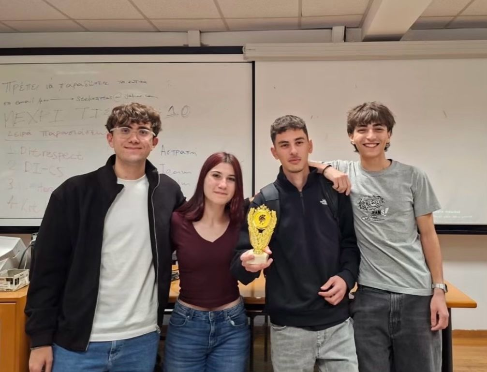

# 🏆 EKPATHON mini 2026 — 1st Place

**3 hours. 4 students. C only. No AI. 1st place among 10 teams.**

Our team participated in EKPATHON mini, a three-hour programming competition organized at the Department of Informatics and Telecommunications of the National and Kapodistrian University of Athens (NKUA).

The challenge was to develop a third feature for an existing OASA public transportation application, focusing on innovation, usefulness, and feasibility.

We developed a **community-driven passenger review system** and won **1st place among 10 participating teams**, evaluated by a panel of professors.

<p align="center">
  
</p>

## ⚡ The Challenge

Each team received an existing terminal-based application written in C, designed to provide information about OASA bus services.

The application already included two features:

- **Feature 1 — Bus Departures:** View scheduled departure times for selected bus lines.
- **Feature 2 — Bus Stop Arrivals:** Select a bus line and stop to view estimated bus arrival times.

Our task was to design and implement **Feature 3**, introducing an original functionality that would add value to the existing application.

### Competition Constraints

- ⏱️ **3 hours** to develop the feature.
- 💻 **C only** — no other programming languages.
- 🚫 **Strictly no AI assistance** for any purpose.
- 💡 The proposed feature had to be innovative, useful, and feasible.

The challenge focused on problem-solving, implementation, and teamwork under strict time constraints.

## 💡 Our Solution — Feature 3: Community Bus Reviews

We developed a passenger reporting system that allows users to submit feedback about their bus journey.

The idea was to complement existing transportation information with insights into the actual passenger experience.

### 📝 Passenger Ratings

Users select a bus line and a stop, then evaluate three aspects of their experience on a scale of 1–10:

| Category | Description |
|---|---|
| 🧍 Crowding | How crowded was the bus? |
| 👥 Personnel | How would you rate the personnel? |
| 🚌 Vehicle Condition | What was the condition of the bus? |

The application calculates the average of the three ratings to produce an overall score for each report.

### 💾 Report Storage

Submitted reports are appended to a local `reports.txt` file.

Each record contains:
- Bus line number.
- Bus line name.
- Selected stop.
- Report submission time.
- Average rating.

Users can also view the accumulated report history directly in the terminal.

### 🎁 Contribution-Based Rewards

To encourage continued participation, we implemented a prototype reward mechanism.

After ten reports, the application displays a notification indicating that the user has earned a free-ticket reward.

The reward system demonstrates the concept of encouraging passengers to contribute feedback. Actual ticket issuance, persistent user accounts, and verified daily streaks are outside the scope of the current implementation.

## 🛠️ Implementation

Our team implemented the third feature in C and integrated it into the existing application.

The implementation includes:
- Interactive terminal-based reporting.
- Integration with the existing bus line and stop selection functionality.
- Collection of three passenger ratings.
- Average score calculation.
- Local file storage and report history.
- A report-counting and reward-notification mechanism.

**Project scope:** The original application, including the bus departure and arrival functionality, was provided by the competition organizer. Our team's contribution was the design and implementation of the third feature: the community-driven passenger review system.

We did not develop the entire OASA application from scratch.


## 🎤 Our Presentation

A successful hackathon is about more than writing code. It's also about communicating an idea, explaining the implementation, and demonstrating its value under time pressure.

Our team presented our solution to the competition judges, showcasing the feature we developed in just three hours using C, without AI assistance.

### 📄 Presentation Slides

📑 **[View our presentation (PDF)](assets/presentation.pdf)**


## 👥 The Team — C-Horses

Four students, three hours, one solution, and **1st place among 10 teams**.

- **Κωνσταντίνος Σαμαρίνας** (*Samarinas Konstantinos*)
- **Χρήστος Μηλαίος** (*Milaios Christos*)
- **Αναστάσης Αναστασίου** (*Anastasiou Anastasis*)
- **Θεανώ Μπαλή** (*Bali Theano*)


## 🚀 How to Run

### Prerequisites

- [Git](https://git-scm.com/)
- A C compiler, such as GCC
- `make`

### Installation & Execution

**1. Clone the repository**

```bash
git clone https://github.com/konsamarinas/ekpathon-mini-2026-1.git
```

**2. Navigate to the project directory**

```bash
cd ekpathon-mini-2026-1
```

**3. Compile the application**

```bash
make
```

**4. Run the application**

```bash
./oasa
```

### Using the Application

Once the application starts, use the terminal menu to select one of the available features:

- **1 — Bus Departures:** View scheduled departures for a selected bus line.
- **2 — Bus Stop Arrivals:** Check estimated arrival times at a selected stop.
- **3 — Add Report / Show All:** Submit a passenger review and view previously saved reports.
- **0 — Exit:** Close the application.

When submitting a report, select a bus line and stop, then rate crowding, personnel, and vehicle condition on a scale of 1–10.

Reports are saved locally in `reports.txt`.


## 🥇 The Result

**1st place out of 10 participating teams.**

Within a three-hour time limit, we designed and implemented our feature and presented the solution to a panel of professors.

The competition challenged us to combine an original idea with practical implementation, using only C and without AI assistance.

Our team was awarded first place for our solution.

## 👥 Team

Developed collaboratively by a team of four students, with responsibilities shared across software development, coding support, and project presentation.

## 🔗 Original Starter Repository

The original application was provided by the competition organizer:

[**steliosrotas/ekpathon-mini-1**](https://github.com/steliosrotas/ekpathon-mini-1)

This repository documents our team's contribution to EKPATHON mini 2026: the development of Feature 3 for the existing OASA application.

---

*An original idea, three hours of development, and a first-place finish.* 🏆
